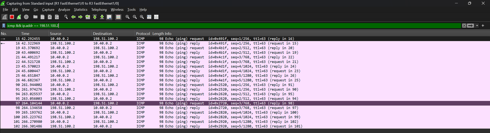
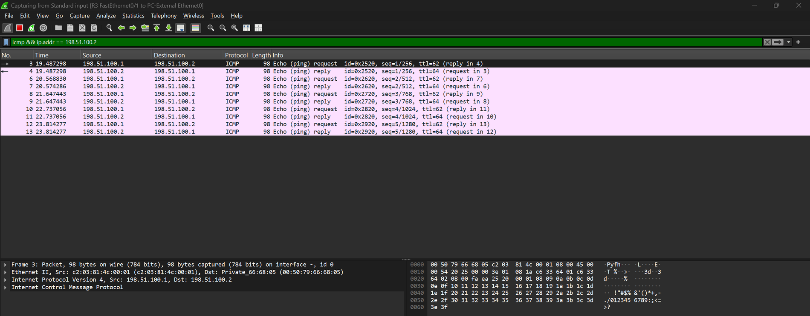
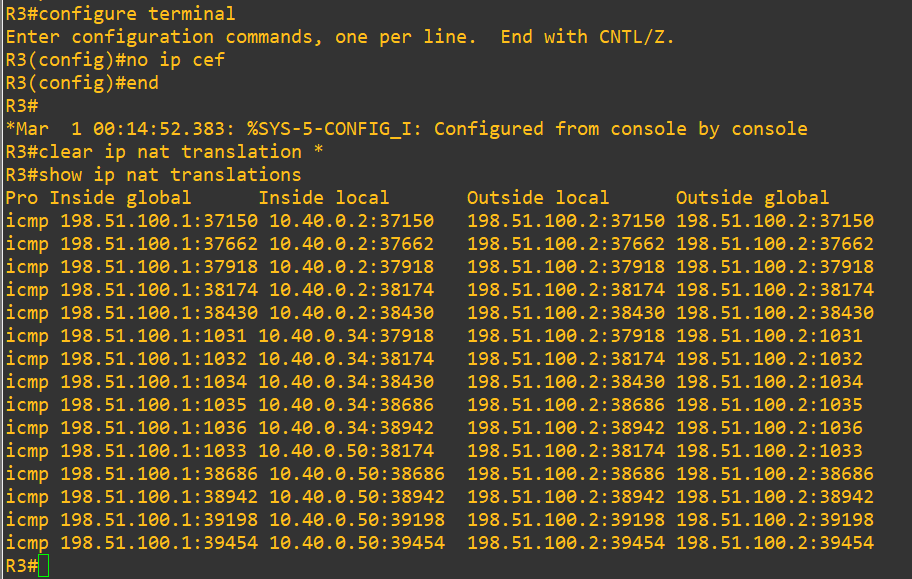
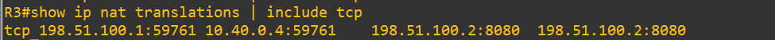

# شبیه‌سازی شبکهٔ ارتباطی مراکز درمانی و فرماندهی

**پروژهٔ درس مهندسی اینترنت** · پیاده‌سازی و آزمایش در `GNS3` · توپولوژی مسیریابی پویا، سرویس وب مرکزی و ترجمهٔ نشانی با `NAT/PAT`

این مخزن یک لَب شبکهٔ قابل اجرا در `GNS3` و شواهد آزمایش‌های آن را نگه می‌دارد. سناریو، سه روتر را در قالب یک مثلث به هم متصل می‌کند تا دو بیمارستان و مرکز فرماندهی هم در حالت عادی ارتباط داشته باشند و هم امکان آزمودن مسیر جایگزین فراهم شود.


> **وضعیت صادقانهٔ پروژه:** طراحی، آدرس‌دهی، `RIPv2`، سرویس `HTTP` و آزمایش‌های `NAT/PAT` انجام و مستند شده‌اند. قطع لینک‌ها و مشاهدهٔ همگرایی مسیر جایگزین هنوز آزمایش نهایی نشده است؛ بنابراین افزونگی مسیریابی در این نسخه **هدف طراحی** است، نه نتیجهٔ تأییدشده.

## فهرست مطالب

- [هدف و سناریو](#هدف-و-سناریو)
- [توپولوژی](#توپولوژی)
- [طرح آدرس‌دهی](#طرح-آدرس‌دهی)
- [چه چیزی پیاده‌سازی و آزمایش شد؟](#چه-چیزی-پیاده‌سازی-و-آزمایش-شد)
- [ساختار مخزن](#ساختار-مخزن)
- [بازکردن و اجرای لَب](#بازکردن-و-اجرای-لب)
- [آزمون‌های باقی‌مانده](#آزمون‌های-باقی‌مانده)
- [گزارش کامل و فایل‌های ضبط](#گزارش-کامل-و-فایل‌های-ضبط)

## هدف و سناریو

سناریو یک شبکهٔ ارتباطی اضطراری را مدل می‌کند:

- بیمارستان اول دارای شبکهٔ کارکنان و شبکهٔ مهمان است.
- بیمارستان دوم شبکهٔ کارکنان خودش را دارد.
- مرکز فرماندهی میزبان وب‌سرور مرکزی است.
- یک شبکهٔ بیرونی شبیه‌سازی‌شده برای آزمودن دسترسی و `NAT/PAT` استفاده می‌شود.
- روترهای `R1`، `R2` و `R3` سه لینک مستقیم دارند؛ این شکل، دو راه بالقوه از هر بیمارستان تا مرکز فرماندهی ایجاد می‌کند.

هدف آموزشی، دیدن نقش زیرشبکه‌بندی `VLSM`، دروازهٔ پیش‌فرض، `ARP`، مسیریابی پویا با `RIPv2`، درخواست `HTTP` روی `TCP` و ترجمهٔ مبدأ با `NAT/PAT` در یک سناریوی یکپارچه است.

## توپولوژی

در این لَب **۳ روتر، ۴ سوئیچ، ۶ رایانهٔ `VPCS` و ۲ ماشین `Tiny Core Linux`** داریم. ارتباط داخلی روترها به صورت مثلثی است؛ `R3` به LAN مرکز فرماندهی و شبکهٔ بیرونی متصل می‌شود.

| بخش | شبکه / دستگاه‌ها | اتصال روتر |
|---|---|---|
| کارکنان بیمارستان اول | `PC-A1`، `PC-A2`، `Linux-Client` | `R1 Fa0/0` |
| مهمان بیمارستان اول | `PC-Guest` | `R1 Fa0/1` |
| کارکنان بیمارستان دوم | `PC-B1`، `PC-B2` | `R2 Fa0/0` |
| مرکز فرماندهی | `Web-Server` | `R3 Fa0/0` |
| شبکهٔ بیرونی آزمایش | `PC-External` | `R3 Fa0/1` |
| لینک‌های روتر به روتر | `R1–R2`، `R1–R3`، `R2–R3` | پورت‌های `FastEthernet` جدول آدرس‌دهی |

## طرح آدرس‌دهی

فضای داخلی از `10.40.0.0/24` با `VLSM` تقسیم شده است. ظرفیت جدول، تعداد نشانی‌های قابل تخصیص به میزبان‌ها را نشان می‌دهد؛ نشانی شبکه و پخش در آن شمرده نشده‌اند.

| بخش | شبکه | ماسک | ظرفیت میزبان | دروازه | میزبان‌های شاخص |
|---|---|---|---:|---|---|
| کارکنان بیمارستان اول | `10.40.0.0/27` | `255.255.255.224` | ۳۰ | `10.40.0.1` | `PC-A1 .2`، `PC-A2 .3`، `Linux-Client .4` |
| کارکنان بیمارستان دوم | `10.40.0.32/28` | `255.255.255.240` | ۱۴ | `10.40.0.33` | `PC-B1 .34`، `PC-B2 .35` |
| مهمان بیمارستان اول | `10.40.0.48/29` | `255.255.255.248` | ۶ | `10.40.0.49` | `PC-Guest .50` |
| مرکز فرماندهی | `10.40.0.56/29` | `255.255.255.248` | ۶ | `10.40.0.57` | `Web-Server .58` |
| لینک `R1–R3` | `10.40.0.64/30` | `255.255.255.252` | ۲ | — | `R1 .65` ↔ `R3 .66` |
| لینک `R2–R3` | `10.40.0.68/30` | `255.255.255.252` | ۲ | — | `R2 .69` ↔ `R3 .70` |
| لینک `R1–R2` | `10.40.0.72/30` | `255.255.255.252` | ۲ | — | `R1 .73` ↔ `R2 .74` |
| بیرونیِ شبیه‌سازی‌شده | `198.51.100.0/30` | `255.255.255.252` | ۲ | `198.51.100.1` | `R3 .1`، `PC-External .2` |

نشانی کوتاه‌شدهٔ `.34` در جدول یعنی `10.40.0.34` و در همان سطرِ شبکهٔ مشخص‌شده تفسیر می‌شود. در هر LAN، دروازه همان نشانی رابط روتر در آن زیرشبکه است.

## چه چیزی پیاده‌سازی و آزمایش شد؟

### آدرس‌دهی و ارتباط پایه

رابط‌های LAN و لینک‌های بین روترها آدرس‌دهی و فعال شدند. نشانی‌های `VPCS` ذخیره شده‌اند. برای دو ماشین لینوکسی، آدرس و مسیر پیش‌فرض پس از راه‌اندازی مجدد نیز برقرار می‌شود.

آزمایش‌های محلی و بین‌شبکه‌ای با `ping` و `traceroute` انجام شدند. جدول‌های `ARP` نیز نشان دادند که برای مقصد هم‌شبکه، میزبان `MAC` مقصد را پیدا می‌کند و برای مقصد خارج از شبکه، ابتدا `MAC` دروازه را به کار می‌برد. در برخی پینگ‌های اول یک بسته از دست رفت و پینگ‌های بعدی پاسخ گرفتند؛ این با زمان لازم برای حل `ARP` سازگار است. برای نسبت‌دادن قطعی علت، باید خود بسته‌های `ARP` و `ICMP` را در ضبط همان آزمایش دید.

### مسیریابی پویا با `RIPv2`

روی هر سه روتر `RIPv2` و `no auto-summary` تنظیم شده است تا مسیرهای زیرشبکه‌ای با ماسک‌های متفاوت حفظ شوند. خروجی `show ip route` مسیرهای مستقیم (`C`) و مسیرهای آموخته‌شده با `R` را نشان داد. لینک‌های مستقیم به مرکز فرماندهی در مسیرهای دیده‌شده قابل استفاده بودند.

نمونهٔ بخش مسیریابی روی هر سه روتر:

```text
router rip
 version 2
 no auto-summary
 network 10.0.0.0
```

روی `R3` شبکهٔ بیرونی هم به فرایند مسیریابی افزوده شد؛ رابط بیرونی غیرفعال از ارسال به‌روزرسانی‌های `RIP` است:

```text
router rip
 network 198.51.100.0
 passive-interface FastEthernet0/1
```

**آزمون قطع لینک و تأیید مسیر جایگزین هنوز انجام نشده است.** تا انجام آن، زمان همگرایی و تداوم ارتباط در خرابی را نتیجهٔ اندازه‌گیری‌شده تلقی نکنید.

### وب‌سرور و ضبط `HTTP`

روی `Web-Server` یک پاسخ‌گوی سبک روی پورت `8080` اجرا شد. کلاینت درخواست `GET` فرستاد و پاسخ ثبت‌شده شامل `HTTP/1.0 200 OK`، نوع `text/plain` و متن `Command Center is online` با طول ۲۵ بایت بود. ضبط `Hospital-B-HTTP.pcapng` تبادل بیمارستان دوم با سرور را نگه می‌دارد.


فیلتر نمایشی برای دیدن این ارتباط در `Wireshark`:

```text
tcp.port == 8080
```

### شبکهٔ بیرونی آزمایش و `NAT/PAT`

روی `R3`، رابط‌های داخلی با `ip nat inside` و رابط متصل به `PC-External` با `ip nat outside` علامت‌گذاری شدند. فهرست دسترسی، چهار شبکهٔ داخلی را انتخاب می‌کند و دستور `overload` چند جریان را با یک نشانی بیرونی مشترک عبور می‌دهد.

آزمایش‌ها شامل پینگ از شبکهٔ داخلی به `PC-External` و درخواست `TCP` از `Linux-Client` به وب‌سرور آزمایشی بیرونی روی پورت `8080` بودند. برای آزمون `TCP`، ماشین `Web-Server` موقتاً به شبکهٔ بیرونی منتقل و نشانی `198.51.100.2` به آن داده شد؛ پس از آزمون، توپولوژی به حالت پایه برگشت. برای جریان ثبت‌شده، مبدأ `10.40.0.4:59761` در سمت بیرون به `198.51.100.1:59761` ترجمه شد و مقصد `198.51.100.2:8080` بود. ضبط‌ها هم درخواست و پاسخ را روی سمت داخلی و هم نشانی ترجمه‌شده را روی سمت بیرونی نشان می‌دهند.










نمونهٔ تنظیم `NAT/PAT` روی `R3`؛ چهار ورودی `ACL` دقیقاً شبکه‌های داخلی این طرح را پوشش می‌دهند:

```text
interface FastEthernet0/0
 ip nat inside
interface FastEthernet1/0
 ip nat inside
interface FastEthernet2/0
 ip nat inside
interface FastEthernet0/1
 ip nat outside
access-list 10 permit 10.40.0.0 0.0.0.31
access-list 10 permit 10.40.0.32 0.0.0.15
access-list 10 permit 10.40.0.48 0.0.0.7
access-list 10 permit 10.40.0.56 0.0.0.7
ip nat inside source list 10 interface FastEthernet0/1 overload
```

`198.51.100.0/30` در این پروژه یک شبکهٔ بیرونیِ **آزمایشی و شبیه‌سازی‌شده** است؛ اتصال واقعی به اینترنت فراهم نمی‌کند. در این IOS شبیه‌سازی‌شده، برای عبور ترافیک پس از مشاهدهٔ ترجمه‌های `NAT` از `no ip cef` استفاده شد. این رفتار به محیط همین لَب مربوط است و نباید به‌عنوان راهکار عمومی برای شبکه‌های واقعی برداشت شود.

## ساختار مخزن

| مسیر | محتوا |
|---|---|
| `lab/proj-1.gns3` | فایل اصلی توپولوژی `GNS3` |
| `lab/images/` | دیسک‌های ماشین‌های لینوکس که در این مخزن قرار دارند |
| `lab/project-files/` | پیکربندی‌های ذخیره‌شده و فایل‌های پروژهٔ `GNS3` |
| `docs/Internet_Engineering_Progress_Report_FA.docx` | گزارش فارسی کامل با توضیح مراحل، فرمان‌ها و شواهد |
| `docs/IE_P1.pdf` | صورت پروژه |
| `docs/images/` | تصاویر توپولوژی و آزمایش‌ها برای این صفحه |
| `Hospital-B-HTTP.pcapng` | ضبط آزمایش وب از بیمارستان دوم |
| `NAT-PAT-Inside-R1-R3.pcapng` | ضبط ترافیک سمت داخلی `R3` |
| `NAT-PAT-Outside-R3-PC-External.pcapng` | ضبط ترافیک سمت بیرونی `R3` |

## بازکردن و اجرای لَب

۱. `GNS3 2.2.61` را نصب کنید و مخزن را کلون کنید.

۲. فایل `lab/proj-1.gns3` را در `GNS3` باز کنید.

۳. این لَب با روتر `Cisco C3725` و `IOS 12.4(15)T14` ساخته شده است. فایل `IOS` همراه مخزن نیست و باید از ایمیج مجاز و تنظیم محلی خودتان استفاده کنید.

۴. فایل توپولوژی فعلی، نشانی محلی دیسک‌های لینوکس را به مسیر `C:/Users/user/GNS3/projects/proj/images/` ارجاع می‌دهد. اگر این مسیر در رایانهٔ شما وجود ندارد، تنظیم هر دو گرهٔ `QEMU` را در `GNS3` باز کنید و دیسک متناظر را از `lab/images/` انتخاب کنید.

۵. ماشین‌ها و روترها را روشن کنید. برای ترتیب بازبینی و فرمان‌های دقیق، از گزارش فارسی در `docs/Internet_Engineering_Progress_Report_FA.docx` استفاده کنید.

۶. فایل‌های `pcapng` را با `Wireshark` باز کنید یا هنگام اجرای دوبارهٔ آزمون از رابط مناسب ضبط بگیرید.

## آزمون‌های باقی‌مانده

مهم‌ترین کار بعدی، تأیید عملی افزونگی است:

۱. از وضعیت عادی، دسترسی به `10.40.0.58` و جدول مسیرهای روترهای `R1`، `R2` و `R3` را ثبت کنید.
۲. فقط لینک `R1–R3` را در هر دو سر خاموش کنید؛ سپس مسیر و دسترسی را تا همگرایی `RIPv2` دوباره بررسی کنید. مسیر مورد انتظار از `R1` به `R2` و سپس `R3` است.
۳. لینک را برگردانید و سلامت حالت عادی را تأیید کنید.
۴. همین آزمون را جداگانه برای لینک `R2–R3` انجام دهید. مسیر مورد انتظار از `R2` به `R1` و سپس `R3` است.
۵. زمان قطعی، زمان بازگشت پاسخ، مسیر جدید و شواهد `Wireshark` را ثبت کنید؛ از روی طرح به‌تنهایی نتیجه‌گیری نکنید.
۶. گزارش نهایی و ارائه را با شواهد واقعی آزمون افزونگی تکمیل کنید.

## گزارش کامل و فایل‌های ضبط

گزارش Word جزئیات توالی کار، جدول کامل نشانی‌ها، دلیل فرمان‌ها، شواهد، خطاهای تجربه‌شده و راهنمای آزمون باقی‌مانده را شرح می‌دهد: [گزارش پیشرفت پروژه](docs/Internet_Engineering_Progress_Report_FA.docx).

برای مشاهدهٔ بسته‌ها، فایل‌های `pcapng` بالا را در `Wireshark` باز کنید. تصویرهای این صفحه برای مرور سریع‌اند و فایل ضبط‌شده امکان بررسی جزئیات هر بسته را می‌دهد.
