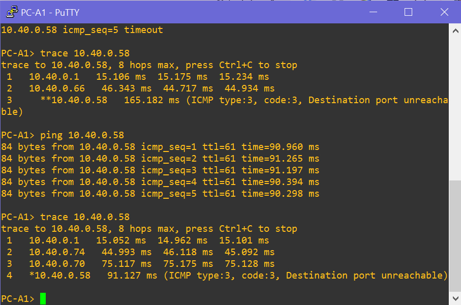
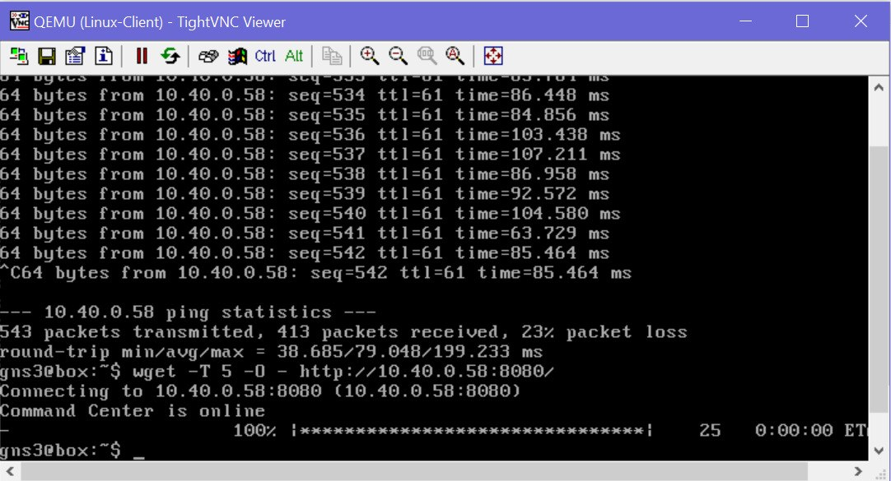
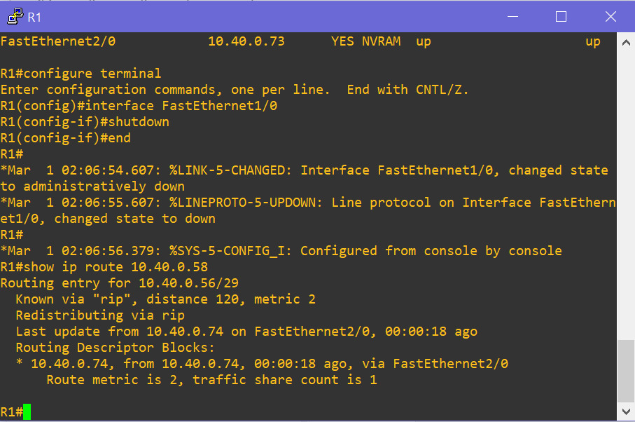
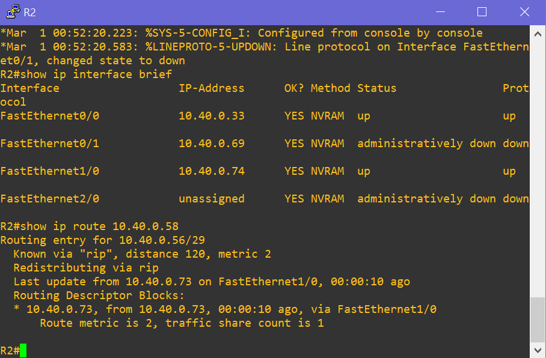
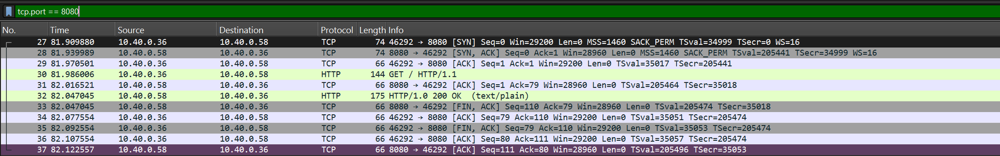

# Emergency Communications Network Lab

**University of Isfahan · Internet Engineering · Project 1**

Two hospitals depend on a crisis command center for emergency updates. This GNS3 lab shows how both hospitals can reach the center's web service, recover access after a direct link fails, and use a shared gateway to reach a simulated external network.

[Assignment brief (Persian)](docs/IE_P1.pdf) · [Final report (Persian)](docs/Internet_Engineering_Final_Report_FA.docx) · [Open the lab](#run-the-lab) · [Failover results](#link-failure-and-recovery)


## What the assignment asks for

The assignment calls for an emergency communications network linking Hospital A, Hospital B, and a crisis command center. Each site has a router, and the three routers form a triangle. Each hospital normally uses its direct link to reach the central web service. If that link fails, the hospital must regain access through the other hospital once `RIPv2` converges, without adding a static route. Restoring the failed link must restore the direct path. A temporary interruption during convergence is allowed.

The design also calls for separate staff and guest LANs at Hospital A, a staff LAN at Hospital B, and a LAN for the command center. The assignment provides `10.40.0.0/24` for the internal address plan, requires a separate `/30` for each router link, and reserves `198.51.100.0/30` for the simulated external segment. Both staff networks and the guest network must reach that segment through `NAT/PAT` on `R3`.

| Required demonstration | Result in the final report |
| --- | --- |
| Address the four LANs and three router links with non-overlapping subnets | The VLSM plan meets the required capacities. Local host and gateway tests succeeded. |
| Explain local and routed forwarding | Wireshark captures show a host resolving the peer's MAC address on the same subnet and the gateway's MAC address for a remote subnet. |
| Route across sites with `RIPv2` | All three routers exchanged routes. Each hospital used its direct link to reach the command center in the baseline tests. |
| Serve HTTP from the command center | A Linux client received the expected response from each hospital in separate tests. The Hospital B capture shows the TCP handshake, HTTP request and response, and connection teardown. |
| Translate traffic at the external gateway | Both staff LANs and the guest LAN reached the external host. Captures show the address rewrite on either side of `R3`, and the NAT table records a separate TCP test. |
| Recover from either direct-link failure | Both links were disabled and restored in separate experiments. Each hospital regained ping and HTTP access on its alternate path. Routing tables show the direct paths were preferred again after restoration. |

## Topology and IPv4 plan

The lab uses three Cisco C3725 routers, four Ethernet switches, six VPCS hosts, and two Tiny Core Linux machines under QEMU. `R1` connects Hospital A's staff and guest LANs through separate interfaces. `R2` serves Hospital B staff. `R3` connects the web server and the simulated external host.

| Segment | Subnet | Usable addresses | Required capacity | Gateway and hosts |
| --- | --- | --- | --- | --- |
| Hospital A staff | `10.40.0.0/27` | `10.40.0.1–10.40.0.30` (30) | 20 | `R1 Fa0/0` at `10.40.0.1`. Hosts `PC-A1` (.2), `PC-A2` (.3), `Linux-Client` (.4). |
| Hospital B staff | `10.40.0.32/28` | `10.40.0.33–10.40.0.46` (14) | 10 | `R2 Fa0/0` at `10.40.0.33`. Hosts `PC-B1` (.34), `PC-B2` (.35). |
| Hospital A guest | `10.40.0.48/29` | `10.40.0.49–10.40.0.54` (6) | 5 | `R1 Fa0/1` at `10.40.0.49`. Host `PC-Guest` (.50). |
| Command center | `10.40.0.56/29` | `10.40.0.57–10.40.0.62` (6) | 4 | `R3 Fa0/0` at `10.40.0.57`. Host `Web-Server` (.58). |
| Simulated external | `198.51.100.0/30` | `198.51.100.1–198.51.100.2` (2) | 2 link endpoints | `R3 Fa0/1` at `198.51.100.1` and `PC-External` at `198.51.100.2`. |

The shorthand `.34`, for example, means `10.40.0.34` in the Hospital B staff LAN. Each LAN uses the first usable address for its router interface. Usable capacity includes the gateway and excludes the network and broadcast addresses.

| Router link | Subnet | Endpoint 1 | Endpoint 2 |
| --- | --- | --- | --- |
| `R1–R3` | `10.40.0.64/30` | `R1 Fa1/0 · 10.40.0.65` | `R3 Fa1/0 · 10.40.0.66` |
| `R2–R3` | `10.40.0.68/30` | `R2 Fa0/1 · 10.40.0.69` | `R3 Fa2/0 · 10.40.0.70` |
| `R1–R2` | `10.40.0.72/30` | `R1 Fa2/0 · 10.40.0.73` | `R2 Fa1/0 · 10.40.0.74` |

## Link failure and recovery

Both experiments started with all three links active. The team disabled the interfaces at both ends of one direct link, inspected the route to `10.40.0.56/29`, and tested the web server at `10.40.0.58` from the affected hospital. After each experiment, the team restored the link and confirmed that the original next hop returned.

| Direct link disabled | Baseline next hop | Next hop after convergence | Next hop after restoration |
| --- | --- | --- | --- |
| `R1–R3` | `10.40.0.66` via R3, metric **1** | `10.40.0.74` via R2, metric **2** | `10.40.0.66` via R3, metric **1** |
| `R2–R3` | `10.40.0.70` via R3, metric **1** | `10.40.0.73` via R1, metric **2** | `10.40.0.70` via R3, metric **1** |

Hospital A's traceroute confirmed `R1 → R2 → R3`, and Hospital B's traceroute confirmed `R2 → R1 → R3`. Each affected hospital received five replies in a post-convergence ping check and retrieved the expected HTTP response while its direct link was still down.



During Hospital B's continuous ping run, 413 of 543 probes received replies. This is the total for the run. The report records recovery and does not give a separate convergence time.



<details>
<summary>Router output during failover and after link restoration</summary>

**Hospital A** · Route via `10.40.0.74` at metric 2. [Direct route after restoration](docs/images/recovery-hospital-a-route.jpg).



**Hospital B** · Route via `10.40.0.73` at metric 2. [Direct route after restoration](docs/images/recovery-hospital-b-route.jpg).



</details>

## Protocol and packet evidence

### Local forwarding and RIPv2

`PC-A1` resolved `PC-A2` directly with ARP when both were on the staff LAN. When it pinged the guest host at `10.40.0.50`, the packet kept that destination IP and the first Ethernet frame used the MAC address of its gateway, `10.40.0.1`. [ARP and ICMP screenshot](docs/images/arp-gateway-wireshark.jpg).

All three routers run `RIPv2` with automatic summarization disabled. Frame **5** of the Hospital B capture shows `R3` advertising the command-center subnet `10.40.0.56/29` with metric 1 over `UDP/520` to `224.0.0.9`. `R3` also advertises the simulated external subnet to the internal routers and suppresses updates on the external interface. [Hospital B packet capture](Hospital-B-HTTP.pcapng).

### Central web service

The Tiny Core web server at `10.40.0.58:8080` returns `Command Center is online`. The same Linux client tested from Hospital A at `10.40.0.4/27` and then from Hospital B at `10.40.0.36/28`. In the Hospital B capture, frames **27–29** establish the TCP connection, frame **30** contains `GET /`, and frame **32** contains `HTTP/1.0 200 OK` with a 25-byte body. Later frames show TCP teardown.



### NAT/PAT at the external gateway

`R3` uses `Fa0/1` as its outside interface. PAT lets internal hosts share `198.51.100.1` for outbound traffic. `PC-A1`, `PC-B1`, and `PC-Guest` each reached `198.51.100.2`; their ICMP translations appear in the [NAT table screenshot](docs/images/nat-translations.png).

| ICMP packet with ID `0x2520` | Inside R3 | Outside R3 |
| --- | --- | --- |
| Echo request | `10.40.0.2 → 198.51.100.2` (frame 90) | `198.51.100.1 → 198.51.100.2` (frame 3) |
| Echo reply | `198.51.100.2 → 10.40.0.2` (frame 91) | `198.51.100.2 → 198.51.100.1` (frame 4) |

For the separate TCP test, the web server temporarily took the external address `198.51.100.2` and served port `8080`. The translation table shows `10.40.0.4:59761` mapped to `198.51.100.1:59761`. The client received the HTTP response. The web server and external host were then returned to their original locations. [TCP translation screenshot](docs/images/pat-tcp-translation.png).

<details>
<summary>Wireshark views before and after address translation</summary>

**Inside R3** · The request source and reply destination are `10.40.0.2`.


**Outside R3** · The packets use `198.51.100.1` in place of the private address.


</details>

### Open the captures in Wireshark

| Capture | Display filter | What to look for |
| --- | --- | --- |
| [Hospital-B-HTTP.pcapng](Hospital-B-HTTP.pcapng) | `tcp.port == 8080` or `rip` | HTTP exchange and the RIPv2 advertisement on the R2–R3 link. |
| [NAT-PAT-Inside-R1-R3.pcapng](NAT-PAT-Inside-R1-R3.pcapng) | `icmp && ip.addr == 198.51.100.2` | Original internal source on the request and restored private destination on the reply. |
| [NAT-PAT-Outside-R3-PC-External.pcapng](NAT-PAT-Outside-R3-PC-External.pcapng) | `icmp && ip.addr == 198.51.100.2` | The shared outside address on the translated request and incoming reply. |

## Run the lab

1. Clone the repository. The project was built with **GNS3 2.2.61** using the local server, Dynamips, and QEMU.
2. Add your own authorized Cisco C3725 IOS image to GNS3. The project references `c3725-adventerprisek9-mz.124-15.T14.image`.
3. Open [lab/proj-1.gns3](lab/proj-1.gns3). The two QEMU nodes reference paths from the original workstation. If needed, point them to your local `qemu-system-i386` executable and their respective disk files, `lab/images/Linux-Client.qcow2` and `lab/images/Web-Server.qcow2`.
4. Start the nodes. The baseline puts `Linux-Client` on `SW-A-Staff` at `10.40.0.4/27` and `Web-Server` on `SW-Command` at `10.40.0.58/29`. For Hospital B's web test, move the client to `SW-B-Staff` and use `10.40.0.36/28` with gateway `10.40.0.33`.
5. If needed, start the listener from the `Web-Server` console, then request the page from `Linux-Client`.

```sh
# Web-Server
nc -lk -s 10.40.0.58 -p 8080 -e /opt/ie-http-response.sh &

# Linux-Client
wget -T 5 -O - http://10.40.0.58:8080/
```

The expected response body is `Command Center is online`. On the routers, use `show ip route 10.40.0.58` for the current next hop and `show ip nat translations` on `R3` immediately after generating external traffic.

To repeat a failover test, use the router-link table to identify the two interfaces, disable one direct link, and compare the learned next hop and HTTP response with the baseline. Restore both interfaces and confirm metric 1 before testing the other link. The assignment evaluates these observations and their explanation in a live demonstration.

## Project files

| Path | Contents |
| --- | --- |
| [lab/proj-1.gns3](lab/proj-1.gns3) | GNS3 project and topology. |
| [lab/images/](lab/images/) | Tiny Core disks for the Linux client and web server. |
| [lab/project-files/](lab/project-files/) | Saved router and VPCS configurations. |
| [docs/IE_P1.pdf](docs/IE_P1.pdf) | Original assignment specification in Persian. |
| [Final report](docs/Internet_Engineering_Final_Report_FA.docx) | Addressing, configuration, test results, and evidence, including both failover scenarios in sections 9–11. |
| [docs/images/](docs/images/) | Screenshots from the lab and final report. |
