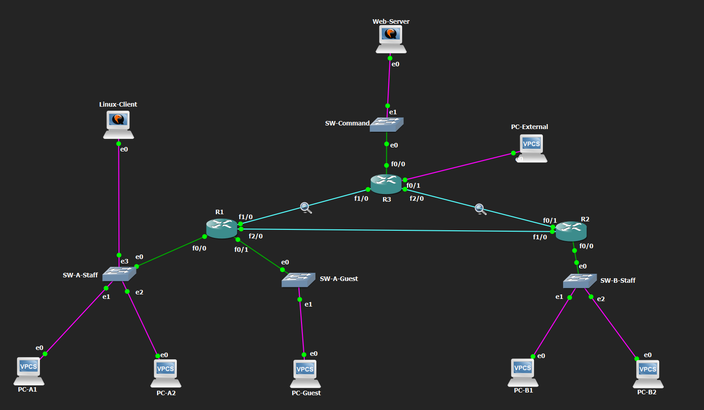
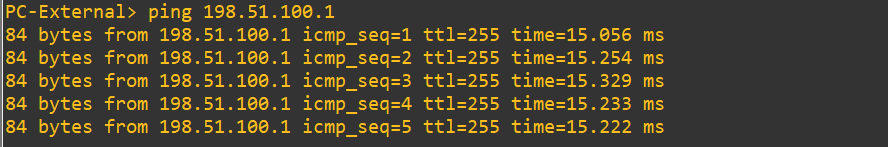

# Emergency Healthcare Network Lab

**Internet Engineering course project** · Built and tested in `GNS3` · Dynamic routing, a central HTTP service, and `NAT/PAT`

This repository contains a runnable network lab and evidence from its experiments. Three routers form a triangle so two hospitals and a command center can communicate over the normal paths, with alternate paths available for a planned failover test.



> **Project status:** Topology, addressing, `RIPv2`, the HTTP service, and `NAT/PAT` experiments have been implemented and documented. Link failure and route convergence have **not yet been tested**. Redundant routing is therefore a design goal, not a verified result.

## Contents

- [Scenario and goals](#scenario-and-goals)
- [Topology](#topology)
- [Address plan](#address-plan)
- [Implementation and verified results](#implementation-and-verified-results)
- [Repository layout](#repository-layout)
- [Open and run the lab](#open-and-run-the-lab)
- [Remaining work](#remaining-work)
- [Full report and packet captures](#full-report-and-packet-captures)

## Scenario and goals

The lab models an emergency communications network:

- Hospital A has a staff LAN and a guest LAN.
- Hospital B has its own staff LAN.
- The command center hosts the central web server.
- A simulated external network is used to test reachability and `NAT/PAT`.
- Routers `R1`, `R2`, and `R3` have direct links between each pair, creating two potential routes from either hospital to the command center.

The lab demonstrates `VLSM` subnetting, default gateways, `ARP`, dynamic routing with `RIPv2`, `HTTP` over `TCP`, and source address translation with `NAT/PAT` in one integrated scenario.

## Topology

The lab has **3 routers, 4 Ethernet switches, 6 `VPCS` hosts, and 2 `Tiny Core Linux` machines**. The router links form a triangle; `R3` also connects to the command-center LAN and the simulated external network.

| Segment | Network / devices | Router connection |
|---|---|---|
| Hospital A staff | `PC-A1`, `PC-A2`, `Linux-Client` | `R1 Fa0/0` |
| Hospital A guest | `PC-Guest` | `R1 Fa0/1` |
| Hospital B staff | `PC-B1`, `PC-B2` | `R2 Fa0/0` |
| Command center | `Web-Server` | `R3 Fa0/0` |
| Simulated external network | `PC-External` | `R3 Fa0/1` |
| Inter-router links | `R1–R2`, `R1–R3`, `R2–R3` | `FastEthernet` interfaces in the address plan |

## Address plan

The internal address space `10.40.0.0/24` is divided with `VLSM`. Usable capacity excludes the network and broadcast addresses.

| Segment | Subnet | Mask | Usable hosts | Gateway | Key hosts |
|---|---|---|---:|---|---|
| Hospital A staff | `10.40.0.0/27` | `255.255.255.224` | 30 | `10.40.0.1` | `PC-A1 .2`, `PC-A2 .3`, `Linux-Client .4` |
| Hospital B staff | `10.40.0.32/28` | `255.255.255.240` | 14 | `10.40.0.33` | `PC-B1 .34`, `PC-B2 .35` |
| Hospital A guest | `10.40.0.48/29` | `255.255.255.248` | 6 | `10.40.0.49` | `PC-Guest .50` |
| Command center | `10.40.0.56/29` | `255.255.255.248` | 6 | `10.40.0.57` | `Web-Server .58` |
| `R1–R3` link | `10.40.0.64/30` | `255.255.255.252` | 2 | — | `R1 .65` ↔ `R3 .66` |
| `R2–R3` link | `10.40.0.68/30` | `255.255.255.252` | 2 | — | `R2 .69` ↔ `R3 .70` |
| `R1–R2` link | `10.40.0.72/30` | `255.255.255.252` | 2 | — | `R1 .73` ↔ `R2 .74` |
| Simulated external | `198.51.100.0/30` | `255.255.255.252` | 2 | `198.51.100.1` | `R3 .1`, `PC-External .2` |

Short host values such as `.34` mean `10.40.0.34` within the subnet shown in that row. Each LAN's default gateway is the router interface address on that same subnet.

## Implementation and verified results

### Addressing and basic connectivity

LAN and inter-router interfaces were addressed and brought up. `VPCS` addresses were saved. Both Linux machines were configured to restore their addresses and default routes after reboot.

Local and inter-subnet connectivity was checked with `ping` and `traceroute`. `ARP` tables showed that a host resolves the destination's `MAC` address for same-subnet traffic, and resolves the gateway's `MAC` address for off-subnet traffic. Some first ping attempts lost one packet before later attempts succeeded. This is consistent with time spent resolving `ARP`; a packet capture from that exact test is needed to confirm the cause.

### Dynamic routing with `RIPv2`

`RIPv2` and `no auto-summary` were configured on all three routers so subnets with different masks remain distinct. `show ip route` showed directly connected (`C`) routes and learned (`R`) routes. The direct paths toward the command center appeared in the observed routing tables.

The routing process configured on each router:

```text
router rip
 version 2
 no auto-summary
 network 10.0.0.0
```

On `R3`, the external network was also added to `RIP`. The external interface is passive, so routing updates are not sent out to the external host:

```text
router rip
 network 198.51.100.0
 passive-interface FastEthernet0/1
```

**Link-failure and alternate-route tests remain outstanding.** Convergence time and connectivity during a failure must not be reported as measured until those tests are performed.

### Web server and `HTTP` capture

A lightweight response service ran on `Web-Server` at port `8080`. The client sent a `GET` request and the captured response contained `HTTP/1.0 200 OK`, content type `text/plain`, and the 25-byte body `Command Center is online`. The capture [Hospital-B-HTTP.pcapng](Hospital-B-HTTP.pcapng) records the request from Hospital B to the server.


Display filter used in `Wireshark`:

```text
tcp.port == 8080
```

### Simulated external network and `NAT/PAT`

On `R3`, the internal interfaces were marked `ip nat inside`; the interface connected to `PC-External` was marked `ip nat outside`. An access list selects the four internal networks, and `overload` lets multiple flows share the outside interface address.

Experiments included pings from an internal host to `PC-External` and a `TCP` request from `Linux-Client` to an external test web server on port `8080`. For the `TCP` test, `Web-Server` was temporarily moved to the external network and assigned `198.51.100.2`; the original topology was restored afterward. In the captured flow, source `10.40.0.4:59761` was translated to `198.51.100.1:59761`, and the destination was `198.51.100.2:8080`. Captures show the request and response on the inside and the translated address on the outside.





Core `NAT/PAT` configuration on `R3`. The four access-list entries match the internal subnets in this design:

```text
interface FastEthernet0/0
 ip nat inside
interface FastEthernet1/0
 ip nat inside
interface FastEthernet2/0
 ip nat inside
interface FastEthernet0/1
 ip nat outside
exit
access-list 10 permit 10.40.0.0 0.0.0.31
access-list 10 permit 10.40.0.32 0.0.0.15
access-list 10 permit 10.40.0.48 0.0.0.7
access-list 10 permit 10.40.0.56 0.0.0.7
ip nat inside source list 10 interface FastEthernet0/1 overload
```

`198.51.100.0/30` is a simulated test network, not a real Internet connection. In this simulated IOS environment, `no ip cef` was used after translations appeared without traffic passing. Treat this as a workaround specific to this lab, not as general advice for production networks.

## Repository layout

| Path | Contents |
|---|---|
| `lab/proj-1.gns3` | Main `GNS3` topology file |
| `lab/images/` | Linux machine disks included in this repository |
| `lab/project-files/` | Saved `GNS3` project and device configuration files |
| `docs/Internet_Engineering_Progress_Report_FA.docx` | Detailed Persian report with steps, commands, and evidence |
| `docs/IE_P1.pdf` | Project specification |
| `docs/images/` | Topology and experiment images used on this page |
| [Hospital-B-HTTP.pcapng](Hospital-B-HTTP.pcapng) | Hospital B web experiment capture |
| [NAT-PAT-Inside-R1-R3.pcapng](NAT-PAT-Inside-R1-R3.pcapng) | Capture from the inside link of `R3` |
| [NAT-PAT-Outside-R3-PC-External.pcapng](NAT-PAT-Outside-R3-PC-External.pcapng) | Capture from the outside link of `R3` |

## Open and run the lab

1. Install `GNS3 2.2.61` and clone this repository.
2. Open `lab/proj-1.gns3` in `GNS3`.
3. The lab uses a `Cisco C3725` router with `IOS 12.4(15)T14`. The IOS image is not included; configure the router template with an image you are authorized to use.
4. The current topology file points to Linux disks under `C:/Users/user/GNS3/projects/proj/images/`. If that path does not exist on your computer, edit both `QEMU` nodes in `GNS3` and select their disk files from `lab/images/`.
5. Start the routers and hosts. The Persian report at `docs/Internet_Engineering_Progress_Report_FA.docx` contains detailed commands and a step-by-step record.
6. Open the supplied `pcapng` captures in `Wireshark`, or capture on the appropriate link while repeating an experiment.

## Remaining work

The next major task is to verify routing redundancy in the running lab:

1. From the normal state, record reachability to `10.40.0.58` and routing tables on `R1`, `R2`, and `R3`.
2. Shut down both ends of only the `R1–R3` link. Recheck the route and connectivity while `RIPv2` converges. Expected path: `R1` → `R2` → `R3`.
3. Restore that link and confirm the normal state.
4. Repeat separately for the `R2–R3` link. Expected path: `R2` → `R1` → `R3`.
5. Record outage duration, time until replies resume, the new route, and packet-capture evidence. Do not infer these results from the topology alone.
6. Add the verified failover evidence to the final report and presentation.

## Full report and packet captures

The detailed [project progress report](docs/Internet_Engineering_Progress_Report_FA.docx) documents the work sequence, full address plan, command explanations, evidence, troubleshooting, and remaining tests.

Open the `pcapng` files in `Wireshark` to inspect individual packets. The images above provide a quick overview; the captures retain packet-level details.
